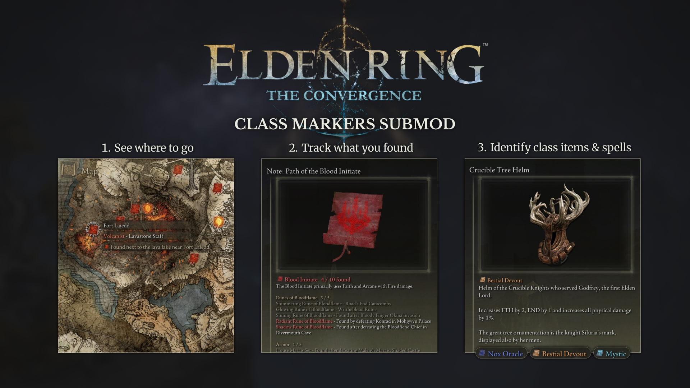

# Class Markers for The Convergence



[](https://github.com/SjorsWijsman/ClassMarkers/releases/latest)
[](LICENSE)

A mod for ELDEN RING's [The Convergence](https://www.nexusmods.com/eldenring/mods/3419) overhaul
that puts the items from your class notes on the world map and tracks what you've found.

The Convergence's class notes ("Note: Path of the …" / "Note: Weapons for …") list the spell runes,
armor and weapons that suit a class, and where to find them. Class Markers turns those lists into
map markers and checklists.

## Features

- **Map markers** for every item in the class notes you carry, with the class's icon, the item's
  name and the note's hint on where to find it. Spell runes show their own rune tier.
- **Only what you're tracking:** a note's markers show while that note is in your inventory. Put a
  note in the storage chest to stop tracking that class, take it out to track it again.
- **Markers disappear** once you have the item: picked up, in your inventory or in the chest.
- **Class notes as checklists:** each note shows your progress ("Nox Oracle 5 / 10 found"), and
  found entries turn grey.
- **Item descriptions** start with the classes whose notes list the item, or that start with it,
  each with its class colour and icon.
- **Nothing is overwritten:** The Convergence's files and the game's files stay untouched. The mod
  is a plugin for Convergence's launcher, plus one entry it adds to Convergence's launch profiles,
  which `Uninstall.bat` removes again.

## For players

### Requirements

- ELDEN RING with [The Convergence](https://www.nexusmods.com/eldenring/mods/3419) installed,
  started with `Start_Convergence.bat`.
- Note: Works with Seamless Co-op (Convergence's Seamless profile is set up too).

### Install

1. Download `ClassMarkers-<version>.zip` from the
   [latest release](https://github.com/SjorsWijsman/ClassMarkers/releases/latest).
2. Unzip it into your `ConvergenceER` folder, so you get `ConvergenceER\ClassMarkers` next to
   Convergence's `mod` and `me3` folders.
3. Run `ClassMarkers\Install.bat`.
4. Start the game with `Start_Convergence.bat` as usual.

The first start takes a few seconds longer: the mod makes its icons from The Convergence's own art.

### How to use it

Pick up a class note (or keep the one you start with) and open the map: the items it lists are
marked. Hover a marker for the item and the note's hint. Open the note in your inventory to see
what you've found. Put notes you're not interested in in the storage chest.

### After a Convergence update

Run `Install.bat` again: Convergence's updates replace its launch profiles, and with them our
entry. The markers are made for a specific Convergence version; if things are missing or
misplaced after an update, check the [releases](https://github.com/SjorsWijsman/ClassMarkers/releases)
for a newer Class Markers.

### Uninstall

Run `Uninstall.bat`, then delete the `ClassMarkers` folder.

### Make it yours

The icons the mod makes are kept in `ClassMarkers\mod\icons\`. To change one, copy it to the same
place under `ClassMarkers\icons\` and edit it there: a file in `icons\` always wins.

| File                                              | What                                                                      |
| ------------------------------------------------- | ------------------------------------------------------------------------- |
| `icons\notes\<Class> (path).png`, `(weapons).png` | The class icons in item descriptions and notes                            |
| `icons\map\<Class> (path).png`, `(weapons).png`   | The map markers                                                           |
| `icons\map\<Class> (<Tier> rune).png`             | The spell rune markers, one per rune tier                                 |
| `icons\colors.txt`                                | Class colours (`Class name = #RRGGBB`) for the text and the markers' glow |

### Troubleshooting

- **Something's missing or wrong:** `ClassMarkers\ClassMarkers.log` is written at every start and
  says what was added, and why if something wasn't. Please attach it when you
  [open an issue](https://github.com/SjorsWijsman/ClassMarkers/issues).
- **No markers at all:** check that you carry a class note, and that you started the game with
  `Start_Convergence.bat` after running `Install.bat`.
- **A few items have no marker:** about 15 note entries can't be placed from the game's data
  (Roundtable Hold merchants, some quest NPCs). Their notes still track them.

## For developers

Everything below is about building the mod from source; players don't need it.

### Building from source

Needs Windows, [Rust](https://rustup.rs), Python 3.10+ and The Convergence
installed.

1. Clone the repo anywhere.
2. Create `convergence_path.txt` in the repo root holding your `ConvergenceER` folder, e.g.
   `D:\Games\Elden Ring The Convergence\ConvergenceER`.
3. `pip install -r tools/requirements.txt`
4. Run `Update.bat`. It reads Convergence's files (`tools/generate.py`), builds the plugin, copies
   `ClassMarkers.dll` to the repo root and installs it into Convergence's launch profiles (linking
   `ConvergenceER\ClassMarkers` to the repo).

Run `Update.bat` again after code changes or a Convergence update (close the game first).

### Project layout

| Path                      | What                                                                                      |
| ------------------------- | ----------------------------------------------------------------------------------------- |
| `plugin/`                 | The plugin (Rust DLL loaded by me3).                                                      |
| `plugin/src/generated.rs` | Marker and note data, written by `tools/generate.py`. Don't edit by hand.                 |
| `tools/generate.py`       | Reads Convergence's files and writes `generated.rs`.                                      |
| `tools/profiles.ps1`      | Adds/removes our entry in Convergence's launch profiles (`Install.bat`, `Uninstall.bat`). |
| `tools/update.ps1`        | `Update.bat`: generate, build, install.                                                   |
| `tools/package.ps1`       | Packs a release zip into `dist/`.                                                         |
| `docs/player-readme.md`   | The README inside the release zip.                                                        |
| `icons/`                  | `colors.txt`, and players' icon overrides.                                                |
| `mod/`                    | Made by the plugin (not in git): our me3 package and the icon cache.                      |

### How it works

- **Item positions** come from Convergence's data: item lots → treasure positions in the map
  files, or the boss/NPC whose defeat awards the lot (event scripts). Items in caves, catacombs,
  tunnels and gaols go on the dungeon's entrance icon. Without an exact spot: an NPC the note names
  that has a map marker ("Given by Gowry" → Gowry), else the map the lot belongs to, on a boss
  marker there the note names, the dungeon's entrance, a landmark or the tile's middle.
- **Markers** are rows added to `WorldMapPointParam` in memory at startup. The world map only draws
  a row whose **id encodes its map block** (`AABBnn` for dungeon map `mAA_BB`, `PPGGZZnn` for world
  tile `GG/ZZ`); the plugin picks a free `nn`. Visibility is switched at runtime through the row's
  event flag (always-on / always-off flags), following which notes you carry and what you own.
- **Text** (marker labels, the class line in descriptions, the rewritten notes) is added to the
  game's text in memory. The notes' and items' own words are read from the game at startup;
  `generated.rs` refers to them by note and line number.
- **Map icons:** the map draws icon N as frame N of sprite 171 in `menu/02_120_worldmap.gfx`. The
  plugin writes a copy of Convergence's movie with our bitmaps and frames to `mod/`, an me3 package
  loaded after Convergence's.
- **Text icons:** description boxes draw `` from the menu icon atlas
  (`menu/hi/01_common.sblytbnd` + `01_common.tpf`, BC7). The plugin adds rows with our icons to a
  copy of that texture and entries to its layout, in `mod/`.
- **The icons themselves** are made at startup from Convergence's art (the note icons from the
  menu atlas, the runes from their detail images, Oodle-compressed) and cached in `mod/icons/`;
  only remade when Convergence's menu files, `colors.txt` or an override change.

### Releasing

GitHub builds releases (`.github/workflows/release.yml`): bump `version` in `plugin/Cargo.toml`,
commit, then push a matching tag:

```
git tag v1.0.1
git push origin v1.0.1
```

The workflow checks the tag matches the version, builds the plugin, packs the zip with
`tools/package.ps1` and attaches it to a new release. Installing from the zip needs no Python, Rust
or `convergence_path.txt`.

## License and credits

The code is [MIT](LICENSE). None of ELDEN RING's or The Convergence's art or text is in the
releases, and in this repo only the banner (`docs/class_markers_banner.png`, their logos and
in-game screenshots) shows any: the plugin reads it from the game while it runs. `plugin/src/generated.rs` holds only
numbers derived from Convergence's data (ids, flags, positions) and the class names. Release zips
list the Rust crates in the DLL in `THIRD-PARTY-NOTICES.md`.

- The technique for growing game tables and text in memory follows
  [Map For Goblins - DLL](https://github.com/VirusAlex/ERR-MapForGoblins-DLL) by VirusAlex (MIT).
- Game structures: [fromsoftware-rs](https://github.com/vswarte/fromsoftware-rs) (MIT/Apache-2.0).
- The Convergence by The Convergence team; ELDEN RING by FromSoftware. Class Markers is a fan
  project, not affiliated with either.
